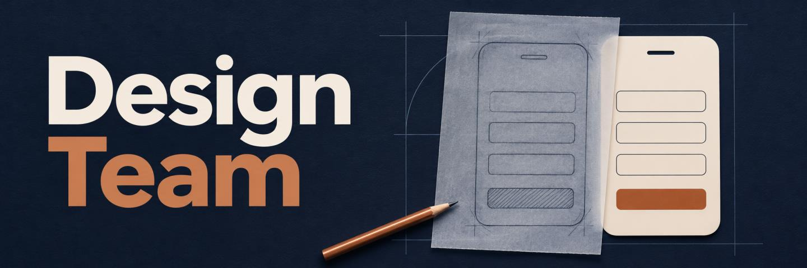
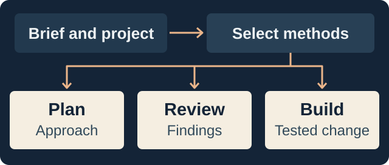
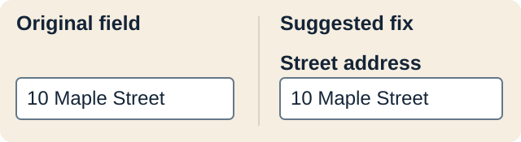

<h1 align="center">Design Team</h1>
<p align="center"><strong>Project-aware design planning and review with Codex.</strong></p>
<p align="center"><strong>English</strong> · <a href="README.vi.md">Tiếng Việt</a></p>
<p align="center">
  <a href="#quick-start">Quick start</a> ·
  <a href="#from-brief-to-result">Pipeline</a> ·
  <a href="#meet-the-toolkit">Toolkit</a> ·
  <a href="#installation">Installation</a> ·
  <a href="#documentation-and-validation">Documentation</a>
</p>

---

**What does this screen need so people can finish their task?** Give Codex a screen, flow or screenshot. Design Team guides it through the project, selects methods from twelve repositories and returns the plan, review or working change you asked for.

> [!NOTE]
> The package installs the coordinating skill and its catalog. Each specialist tool has its own prerequisites. Codex records what it exercised and which checks remain open.

## Quick start

You’ll need access to this repository, Git, PowerShell and Codex. Run these commands from the directory where you keep projects.

```powershell
git clone https://github.com/imnwngr/design-team.git
cd design-team
./scripts/Test-Package.ps1
./scripts/Install-Skill.ps1 -WhatIf
./scripts/Install-Skill.ps1
```

Open **the project you want to design** in a new Codex session. Paste this into the chat and change the page and goal to fit your project.

```text
$design-team Plan a booking page for our studio.
Use our existing colors and booking flow.
Tell me which methods you’d use and how we’ll check that a customer can book.
Plan only.
```

Expect a short plan naming the main action, the design direction, the selected skills and the checks. The installer copies the coordinator and its catalog. You can start planning immediately and check any specialist tool’s prerequisites when you need it.

## From brief to result



| Stage | What Codex does | Output |
|---|---|---|
| Assess | Read the brief, affected screen, components and brand guidance. | Scope, audience and the primary action to check. |
| Select | Choose methods and give each a specific job. | Direction, selected skills and acceptance checks. A plan-only request ends here. |
| Review or build | Trace the problem through the flow or implement the requested change. | Findings with locations or a working interface. |
| Verify | Exercise the main action, keyboard, narrow layout and relevant states. | Observed results and checks still needing evidence. |

## Meet the toolkit

An address field may need only an interface review. Motion and 3D specialists come into play when the brief calls for them.

| Role | Repository | When it helps |
|---|---|---|
| Page direction | [Hallmark](https://github.com/Nutlope/hallmark) | Choose the composition for a new page around its primary action. |
| Brand website | [Taste Skill](https://github.com/Leonxlnx/taste-skill) | Set the typography and art direction for a site with editorial content and photography. |
| Design system | [UI UX Pro Max](https://github.com/nextlevelbuilder/ui-ux-pro-max-skill) | Compare tokens and reusable patterns across screens. |
| Interface review | [Jakub Krehel](https://github.com/jakubkrehel/skills) | Investigate a particular label, layout, focus state or change to a flow. |
| Critique and polish | [Impeccable](https://github.com/pbakaus/impeccable) | Prioritize improvements to a specific screen or component. |
| Quality review | [Anti-slop](https://github.com/miqdadbadjuber/anti-slop) | Check real content, narrow layouts and controls in the chosen direction. |
| Animation | [GSAP Skills](https://github.com/greensock/gsap-skills) | Implement a timeline and check how it behaves with reduced motion. |
| Scroll narrative | [Scroll Craft](https://github.com/nateherkai/scroll-craft) | Plan transitions when the story unfolds as the reader scrolls. |
| Camera flight | [Scroll World](https://github.com/oso95/scroll-world) | Connect scenes into one continuous camera journey. |
| 3D engineering | [Three.js Skills](https://github.com/CloudAI-X/threejs-skills) | Set up a scene, camera and controls for the project’s Three.js version. |
| Image to model | [img2threejs](https://github.com/img2threejs/img2threejs) | Reconstruct a supplied object in code and compare the render with its reference. |
| Diagrams | [Diagram Design](https://github.com/cathrynlavery/diagram-design) | Choose a diagram type and verify labels, connections and branches. |

## Pick a task

| What you need | What to ask Codex | What you get |
|---|---|---|
| A plan | “Plan a booking page using our current brand.” | A direction, selected methods and acceptance checks. |
| A review | “Review address entry on mobile checkout. Report only.” | Ranked issues with a location, evidence and a suggested fix. |
| A working change | “Build the agreed booking page and test the booking action.” | Changes in your project and a record of the interactions tested. |
| A diagram | “Turn this approval process into one HTML diagram. Include rejection.” | A diagram you can open in a browser and compare with the source process. |

Use `$design-team` at the start of any example. A route, screenshot or component path helps Codex find the right starting point.

## See a review

**Sample request.** “Once I start typing on the checkout page, I forget which address field I’m in.” In the sample checkout, entering text at a 390 px viewport made the only visible prompt disappear. A review can point to the exact field and propose a persistent label. The illustration shows that proposal.



**Check the proposed fix.** Enter an address, move focus away, then return with the keyboard. The label should still be visible and associated with the input. The original fixture and the scope of the browser check are documented in the [validation record](VALIDATION.md).

## Installation

<details>
<summary>Try it before installing, or install for one project</summary>

After cloning, give Codex the absolute path to `skills/design-team/SKILL.md` and ask it to follow that file for your brief. Once you install the skill, you can invoke it by name.

The default installation lives at `~/.agents/skills/design-team`. To install only for one project, pass its destination to the installer.

```powershell
./scripts/Install-Skill.ps1 -Destination 'C:\dev\my-project\.agents\skills\design-team'
```

For a manual install, copy the entire `skills/design-team` folder, including `references` and `agents`, to that destination. The installer requires a new destination and preserves an existing installation.

</details>

## Documentation and validation

- How Codex selects methods and hands off results. [Coordinator instructions](skills/design-team/SKILL.md)
- Reviewed revisions, prerequisites and limits for each source. [Routing catalog](skills/design-team/references/catalog.md)
- Package checks, installation tests and browser fixtures. End-to-end execution across all twelve upstream tools remains unverified. [Validation record](VALIDATION.md)

Design Team follows the project-based selection model from [Security Team](https://github.com/imnwngr/security-team) and draws on the [design-skills collection](https://github.com/stars/imnwngr/lists/design-skills).
