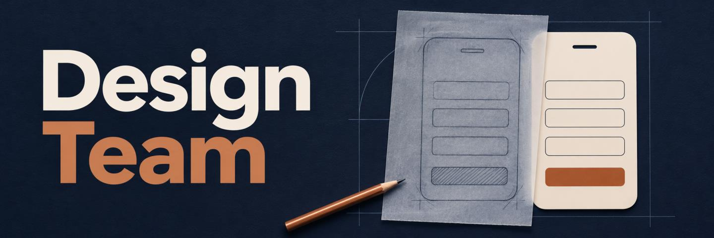
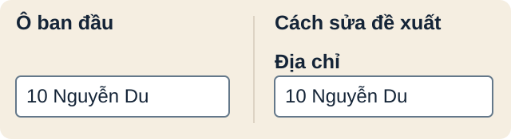

<h1 align="center">Design Team</h1>
<p align="center"><strong>Chọn phương pháp thiết kế theo từng dự án cùng Codex.</strong></p>
<p align="center"><a href="README.md">English</a> · <strong>Tiếng Việt</strong></p>
<p align="center">
  <a href="#bắt-đầu">Bắt đầu</a> ·
  <a href="#từ-yêu-cầu-đến-kết-quả">Quy trình</a> ·
  <a href="#bộ-công-cụ">Bộ công cụ</a> ·
  <a href="#cài-đặt">Cài đặt</a> ·
  <a href="#tài-liệu-và-kiểm-chứng">Tài liệu</a>
</p>

---

**Màn hình này cần cải thiện ở đâu để người dùng hoàn thành được việc của họ?** Bạn đưa Codex tên màn hình, luồng thao tác hoặc ảnh chụp. Design Team hướng dẫn Codex đọc dự án, chọn phương pháp phù hợp trong 12 repo và trả về kế hoạch, bản review hoặc thay đổi để bạn dùng thử.

> [!NOTE]
> Bản cài gồm skill điều phối và danh mục phương pháp. Mỗi công cụ chuyên biệt có điều kiện chạy riêng. Codex ghi rõ phần đã thử và phần còn cần kiểm chứng.

## Bắt đầu

Bạn cần quyền truy cập repo này, Git, PowerShell và Codex. Chạy các lệnh sau trong thư mục bạn thường dùng để lưu dự án.

```powershell
git clone https://github.com/imnwngr/design-team.git
cd design-team
./scripts/Test-Package.ps1
./scripts/Install-Skill.ps1 -WhatIf
./scripts/Install-Skill.ps1
```

Mở phiên Codex mới trong **dự án bạn muốn thiết kế**. Dán yêu cầu sau vào khung chat, thay tên trang và mục tiêu bằng việc bạn đang làm.

```text
$design-team Lên kế hoạch làm trang đặt lịch cho studio.
Dùng màu thương hiệu và luồng đặt lịch hiện có.
Đề xuất cách thiết kế và cách kiểm tra xem khách có đặt lịch được không.
Dừng ở kế hoạch.
```

Bạn sẽ nhận được một kế hoạch ngắn gồm thao tác chính của khách, hướng thiết kế, skill được chọn và cách kiểm tra. Script cài skill điều phối cùng danh mục 12 repo. Khi một việc cần công cụ chuyên biệt, Codex sẽ xem điều kiện chạy của công cụ đó.

## Từ yêu cầu đến kết quả


| Bước | Codex làm gì | Kết quả |
|---|---|---|
| Khảo sát | Đọc yêu cầu, màn hình, component và hướng dẫn thương hiệu sẵn có. | Mục tiêu, phạm vi và thao tác chính cần kiểm tra. |
| Chọn | Đối chiếu danh mục và giao cho mỗi skill một việc cụ thể. | Hướng thiết kế, phương pháp và cách nghiệm thu. Yêu cầu lập kế hoạch dừng ở đây. |
| Review hoặc triển khai | Tái hiện vấn đề trên luồng đang chạy hoặc thực hiện thay đổi đã yêu cầu. | Phát hiện kèm vị trí hoặc giao diện có thể dùng thử. |
| Kiểm chứng | Thử thao tác chính, bàn phím, màn hình hẹp và các trạng thái liên quan. | Kết quả quan sát được và phần còn thiếu bằng chứng. |

## Bộ công cụ

Với một ô nhập địa chỉ, Codex có thể chỉ cần phương pháp review biểu mẫu. Các nguồn cho chuyển động và 3D dành cho những brief thực sự cần đến chúng.

| Vai trò | Repo | Khi nào dùng |
|---|---|---|
| Hướng thiết kế | [Hallmark](https://github.com/Nutlope/hallmark) | Chọn bố cục cho trang mới dựa trên thao tác chính. |
| Website thương hiệu | [Taste Skill](https://github.com/Leonxlnx/taste-skill) | Chọn kiểu chữ và cách dùng ảnh cho trang có nội dung biên tập. |
| Hệ thống thiết kế | [UI UX Pro Max](https://github.com/nextlevelbuilder/ui-ux-pro-max-skill) | Đối chiếu token và mẫu giao diện dùng chung giữa các màn hình. |
| Review giao diện | [Jakub Krehel](https://github.com/jakubkrehel/skills) | Rà một nhãn, bố cục, trạng thái focus hoặc thay đổi trong một luồng. |
| Tinh chỉnh | [Impeccable](https://github.com/pbakaus/impeccable) | Xếp thứ tự các điểm cần cải thiện trên một màn hình hoặc component. |
| Rà chất lượng | [Anti-slop](https://github.com/miqdadbadjuber/anti-slop) | Rà nội dung, bố cục màn hình hẹp và hoạt động của các nút. |
| Hoạt ảnh | [GSAP Skills](https://github.com/greensock/gsap-skills) | Xây chuỗi chuyển động và thử khi người dùng bật chế độ giảm chuyển động. |
| Kể chuyện khi cuộn | [Scroll Craft](https://github.com/nateherkai/scroll-craft) | Thiết kế chuyển cảnh khi nội dung được kể theo nhịp cuộn trang. |
| Di chuyển camera | [Scroll World](https://github.com/oso95/scroll-world) | Nối các cảnh thành một hành trình camera liên tục. |
| Cảnh 3D | [Three.js Skills](https://github.com/CloudAI-X/threejs-skills) | Dựng cảnh, camera và điều khiển theo phiên bản Three.js của dự án. |
| Dựng hình từ ảnh | [img2threejs](https://github.com/img2threejs/img2threejs) | Dựng vật thể bằng code và so sánh hình render với ảnh tham chiếu. |
| Sơ đồ | [Diagram Design](https://github.com/cathrynlavery/diagram-design) | Chọn loại sơ đồ rồi kiểm tra nhãn, đường nối và các nhánh. |

## Chọn việc cần làm

| Bạn cần gì? | Có thể nói với Codex | Bạn nhận được gì? |
|---|---|---|
| Lên kế hoạch | “Lên kế hoạch cho trang đặt lịch theo nhận diện đang dùng.” | Hướng thiết kế, phương pháp được chọn và tiêu chí nghiệm thu. |
| Review giao diện | “Xem giúp bước nhập địa chỉ khi thanh toán trên điện thoại. Chỉ báo cáo.” | Vấn đề theo mức ảnh hưởng, vị trí, bằng chứng và cách sửa đề xuất. |
| Làm giao diện | “Xây trang theo kế hoạch đã chốt và thử thao tác đặt lịch.” | Thay đổi trong dự án cùng kết quả kiểm tra thao tác chính. |
| Vẽ sơ đồ | “Vẽ quy trình duyệt này thành một file HTML, có cả nhánh từ chối.” | Sơ đồ mở được trong trình duyệt để đối chiếu từng nhánh với tài liệu gốc. |

Thêm `$design-team` vào đầu yêu cầu. Nếu đã có giao diện, gửi kèm đường dẫn màn hình, ảnh chụp hoặc tên component để Codex tìm đúng chỗ.

## Xem một ví dụ review

**Tình huống mẫu.** “Ở trang thanh toán, cứ gõ vào là tôi quên ô này đang hỏi địa chỉ gì.” Trong mẫu đã thử ở chiều rộng 390 px, lời nhắc duy nhất biến mất ngay khi người dùng nhập chữ. Codex có thể chỉ ra đúng ô nhập và đề xuất đặt nhãn cố định phía trên. Hình dưới minh họa cách sửa đó.



**Thử lại sau khi sửa.** Nhập địa chỉ, rời ô rồi dùng bàn phím quay lại. Nhãn cần luôn đọc được và liên kết đúng với ô nhập. Có thể xem chi tiết mẫu thử và phạm vi đã kiểm tra trong [biên bản kiểm chứng](VALIDATION.md).

## Cài đặt

<details>
<summary>Thử trước khi cài hoặc chỉ cài cho một dự án</summary>

Sau khi clone, đưa Codex đường dẫn tuyệt đối đến `skills/design-team/SKILL.md` và yêu cầu dùng hướng dẫn trong file đó cho brief của bạn. Sau khi cài, bạn có thể gọi trực tiếp bằng tên skill.

Vị trí cài mặc định là `~/.agents/skills/design-team`. Muốn dùng riêng cho một dự án, dùng đường dẫn đích của dự án như trong ví dụ dưới đây.

```powershell
./scripts/Install-Skill.ps1 -Destination 'C:\dev\my-project\.agents\skills\design-team'
```

Nếu cài thủ công, chép cả thư mục `skills/design-team`, gồm `references` và `agents`, tới vị trí đó. Script yêu cầu thư mục đích mới để giữ nguyên bản đã cài.

</details>

## Tài liệu và kiểm chứng

- Quy tắc chọn phương pháp và bàn giao kết quả. [Hướng dẫn điều phối](skills/design-team/SKILL.md)
- Phiên bản đã khảo sát, điều kiện chạy và giới hạn của từng nguồn. [Danh mục 12 repo](skills/design-team/references/catalog.md)
- Kiểm tra gói, trình cài và các mẫu thử trên trình duyệt. Việc chạy trọn quy trình với cả 12 công cụ vẫn cần kiểm chứng thêm. [Biên bản kiểm chứng](VALIDATION.md)

Design Team kế thừa cách chọn công cụ theo dự án của [Security Team](https://github.com/imnwngr/security-team), từ [danh sách design-skills](https://github.com/stars/imnwngr/lists/design-skills).
