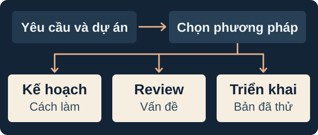

# Design Team

**Cho Codex biết bạn đang làm màn hình nào và người dùng cần làm được gì ở đó.** Design Team giúp Codex chọn phương pháp phù hợp từ 12 repo thiết kế. Bạn có thể xin một bản kế hoạch, nhờ xem lại một bước khó dùng hoặc yêu cầu sửa giao diện rồi thử ngay trong dự án.

[English](README.md) · **Tiếng Việt**

[Bắt đầu](#bắt-đầu) · [Chọn việc cần làm](#chọn-việc-cần-làm) · [Xem một ví dụ review](#xem-một-ví-dụ-review) · [Bộ công cụ](#bộ-công-cụ)

## Bắt đầu

Bạn cần quyền truy cập repo này, Git, PowerShell và Codex. Chạy các lệnh sau trong thư mục bạn thường dùng để lưu dự án.

```powershell
git clone https://github.com/imnwngr/design-team.git
cd design-team
./scripts/Test-Package.ps1
./scripts/Install-Skill.ps1 -WhatIf
./scripts/Install-Skill.ps1
```

Mở phiên Codex mới trong **dự án bạn muốn thiết kế**. Dán yêu cầu sau vào khung chat, thay tên trang và mục tiêu bằng việc bạn đang làm.

```text
$design-team Lên kế hoạch làm trang đặt lịch cho studio.
Dùng màu thương hiệu và luồng đặt lịch hiện có.
Đề xuất cách thiết kế và cách kiểm tra xem khách có đặt lịch được không.
Dừng ở kế hoạch.
```

Bạn sẽ nhận được một kế hoạch ngắn gồm thao tác chính của khách, hướng thiết kế, skill được chọn và cách kiểm tra. Script cài skill điều phối cùng danh mục 12 repo. Khi một việc cần công cụ chuyên biệt, Codex sẽ xem điều kiện chạy của công cụ đó.

<details>
<summary>Thử trước khi cài hoặc chỉ cài cho một dự án</summary>

Sau khi clone, đưa Codex đường dẫn tuyệt đối đến `skills/design-team/SKILL.md` và yêu cầu dùng hướng dẫn trong file đó cho brief của bạn. Sau khi cài, bạn có thể gọi trực tiếp bằng tên skill.

Vị trí cài mặc định là `~/.agents/skills/design-team`. Muốn dùng riêng cho một dự án, dùng đường dẫn đích của dự án như trong ví dụ dưới đây.

```powershell
./scripts/Install-Skill.ps1 -Destination 'C:\dev\my-project\.agents\skills\design-team'
```

Nếu cài thủ công, chép cả thư mục `skills/design-team`, gồm `references` và `agents`, tới vị trí đó. Script yêu cầu thư mục đích mới để giữ nguyên bản đã cài.

</details>

## Từ yêu cầu đến kết quả



## Chọn việc cần làm

| Bạn cần gì? | Có thể nói với Codex | Bạn nhận được gì? |
|---|---|---|
| Lên kế hoạch | “Lên kế hoạch cho trang đặt lịch theo nhận diện đang dùng.” | Hướng thiết kế, phương pháp được chọn và tiêu chí nghiệm thu. |
| Review giao diện | “Xem giúp bước nhập địa chỉ khi thanh toán trên điện thoại. Chỉ báo cáo.” | Vấn đề theo mức ảnh hưởng, vị trí, bằng chứng và cách sửa đề xuất. |
| Làm giao diện | “Xây trang theo kế hoạch đã chốt và thử thao tác đặt lịch.” | Thay đổi trong dự án cùng kết quả kiểm tra thao tác chính. |
| Vẽ sơ đồ | “Vẽ quy trình duyệt này thành một file HTML, có cả nhánh từ chối.” | Sơ đồ mở được trong trình duyệt để đối chiếu từng nhánh với tài liệu gốc. |

Thêm `$design-team` vào đầu yêu cầu. Nếu đã có giao diện, gửi kèm đường dẫn màn hình, ảnh chụp hoặc tên component để Codex tìm đúng chỗ.

## Xem một ví dụ review

**Tình huống mẫu.** “Ở trang thanh toán, cứ gõ vào là tôi quên ô này đang hỏi địa chỉ gì.” Trong mẫu đã thử ở chiều rộng 390 px, lời nhắc duy nhất biến mất ngay khi người dùng nhập chữ. Codex có thể chỉ ra đúng ô nhập và đề xuất đặt nhãn cố định phía trên. Hình dưới minh họa cách sửa đó.


**Thử lại sau khi sửa.** nhập địa chỉ, rời ô rồi dùng bàn phím quay lại. Nhãn cần luôn đọc được và liên kết đúng với ô nhập. Có thể xem chi tiết mẫu thử và phạm vi đã kiểm tra trong [biên bản kiểm chứng](VALIDATION.md).

## Bộ công cụ

Codex bắt đầu từ mục tiêu, giao diện và nhận diện sẵn có. Với trang thanh toán đang chạy, việc cần làm có thể chỉ là rà bố cục và khả năng dùng bàn phím. Với website thương hiệu mới, quyết định đầu tiên có thể là cách dùng chữ và hình ảnh. Mỗi skill được chọn đều có một việc cụ thể và cách kiểm tra kết quả.

| Việc thiết kế | Nguồn Codex tham khảo |
|---|---|
| Chọn hướng thiết kế | **Hallmark** cho bố cục trang mới. **Taste Skill** cho website thương hiệu cần chú trọng chữ và ảnh. |
| Xây hệ thống hoặc sửa một màn hình | **UI UX Pro Max** cho token và mẫu giao diện dùng lại. **Bộ skill của Jakub Krehel** cho bố cục, nhãn, trạng thái focus hoặc review một luồng. |
| Review và hoàn thiện | **Impeccable** để nhận xét và tinh chỉnh một khu vực. **Anti-slop** để rà nội dung, bố cục trên điện thoại và các nút có hoạt động đúng hay không. |
| Thiết kế chuyển động | **GSAP Skills** cho kỹ thuật animation, **Scroll Craft** cho nội dung kể chuyện theo thao tác cuộn và **Scroll World** cho hành trình camera xuyên suốt các cảnh. |
| Làm 3D | **Three.js Skills** cho cảnh, camera và điều khiển. **img2threejs** khi cần dựng vật thể bằng code từ ảnh tham chiếu. |
| Giải thích quy trình | **Diagram Design** cho sơ đồ theo nhận diện, có nhãn dễ đọc và đường nối rõ ràng. |

Danh mục ghi điều kiện chạy và dẫn tới đúng phiên bản đã khảo sát của từng nguồn. Biên bản kiểm chứng ghi kết quả kiểm tra gói, trình cài và các mẫu thử trên trình duyệt. Việc chạy trọn quy trình của cả 12 công cụ vẫn cần kiểm chứng thêm. [Danh mục skill](skills/design-team/references/catalog.md) · [Hướng dẫn điều phối](skills/design-team/SKILL.md) · [Biên bản kiểm chứng](VALIDATION.md)

Design Team kế thừa cách chọn công cụ theo dự án của [Security Team](https://github.com/imnwngr/security-team), từ [danh sách design-skills](https://github.com/stars/imnwngr/lists/design-skills).
